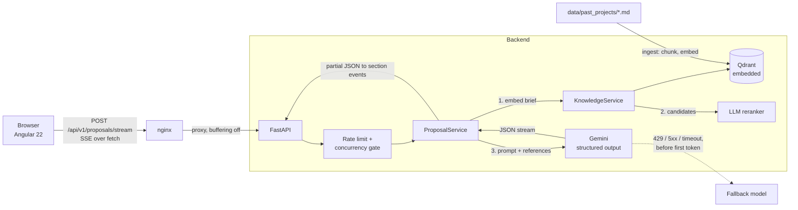

# RFP Proposal Copilot

Turns a client brief into a structured technical proposal (architecture, tech stack, scope with hour estimates, risks), **grounded in the company's own past projects**. The UI streams the proposal section by section and shows exactly which past projects the estimate is based on.

**Stack:** Angular 22 (signals, SSE over `fetch`) · FastAPI · Gemini (structured output + embeddings) · Qdrant · Docker Compose

## Why this is more than an API wrapper

An LLM asked to estimate a project from scratch is confidently wrong: with a naive prompt it quoted roughly **500 hours for projects in the 2,000 to 7,000 hour range**, and even after prompt calibration it still lands at 1,000 to 2,000 hours for them. Retrieval over past projects fixes most of that. The evals measure it on two sets: 20 briefs I tuned the system on, and 15 held-out briefs written afterwards.

| expected range hit, median error | no RAG | RAG, similarity threshold | RAG + LLM reranker |
|---|---|---|---|
| tuned set (20 briefs) | 15%, 56% | 75%, 14% | **95%, 8%** |
| held-out set (15 briefs) | 13%, 53% | 60%, 26% | **80%, 20%** |
| held-out, partial overlap with a past project | 0%, 59% | 40%, 48% | **100%, 19%** |
| held-out, nothing similar in the corpus | 25%, 45% | 50%, 33% | 50%, 36% |
| fresh set (13 briefs, stricter labels) | 15%, 57% | not run yet | 38%, 34% |
| fresh, partial overlap | 0%, 63% | not run yet | 25%, 39% |
| fresh, nothing reusable | 50%, 33% | not run yet | **0%, 52%** |

The held-out set is what keeps this honest. The threshold-only pipeline dropped from 75% to 60% on it, so part of the first result was fitting. The failures were instructive: two of three partial-overlap misses were retrieval misses where no cosine threshold could separate relevant projects (best score 0.675) from irrelevant ones (up to 0.690). That motivated the reranker, which restored recall on the held-out set (82% to 100%) and took partial-overlap briefs from 40% to 100% in range.

**The reranker's gain did not hold on a fresh set.** I then wrote 13 new briefs with stricter labels (close, partial, and "nothing reusable" briefs that share only an industry or generic features with a past project, such as a leave-request tool or a podcast host). With the reranker, only 38% landed in range, and for the "nothing reusable" briefs RAG was *worse than no RAG* (0% against 50%): the judge accepted weak analogies (a healthcare app for a leave tool, an LMS for a podcast platform) and those references pulled estimates off. At the retrieval level, the plain threshold was perfect on this set (100% recall, precision and abstention) even though it missed relevant projects on the held-out set, so neither selection method is robust yet. The threshold-only generation run on this set was cut off by the daily API quota (250 requests per model) and has not been repeated; the cells above are marked accordingly. What this really shows is that 13 to 20 briefs per set is too few to pick a winner, and that each set I tune on stops being a test.

Caveats you should know before trusting these numbers (details in [Known limitations](#known-limitations) and [`backend/evals`](backend/evals/README.md)): the reranker was built after I had seen the held-out failures, so that set is no longer pristine, and the fresh set is the only clean test of it; expected hour ranges are my judgement; runs are single samples (the no-RAG row moved by several points between two runs of the same configuration).

## Architecture



**Request flow**

1. The brief is embedded (`RETRIEVAL_QUERY`) and matched against chunks of past projects in Qdrant.
2. Chunks are grouped by project. Candidates above a low similarity floor go to an LLM judge that scores each past project 0 to 3 by whether its modules are reusable for this brief (not by industry or keywords). Projects scoring 2 or more, at most 3, go into the prompt as real historical data, each with the judge's one-sentence reason, which the UI shows. If the judge fails, selection falls back to a plain similarity threshold.
3. Gemini returns a `ProposalDraft` as schema-constrained JSON, streamed. The server parses the partial JSON on every chunk and emits a `section` event whenever a field changed.
4. When the stream ends, the server validates the full draft, **computes the totals itself** (sum of feature hours), attaches the references and token/latency usage, and sends `complete`.

**SSE events:** `references` → `section` (many) → `complete`; plus `notice` (fallback model in use) and `error`.

## Running it

**With Docker** (everything, one command):

```bash
cp backend/.env.example backend/.env   # set GEMINI_API_KEY (and ADMIN_TOKEN if you want /knowledge/ingest)
docker compose up --build
```

Open <http://localhost:8081> (change with `FRONTEND_PORT`). The backend port is intentionally not published: only nginx can reach the API. On first start the backend indexes the past projects into the `qdrant-data` volume.

**Locally** (needs Node >= 22.22.3 for Angular 22, Python >= 3.12 and [uv](https://docs.astral.sh/uv/)):

```bash
cd backend && uv sync && uv run uvicorn app.main:app --reload   # http://localhost:8000/docs
cd frontend && npm ci && npx ng serve                           # http://localhost:4200
```

**Tests and evals**

```bash
cd backend
uv run pytest                          # 28 tests: rate limits, concurrency, model fallback, reranking, auth
uv run python -m evals retrieval       # embeddings only, cheap
uv run python -m evals generation      # 40 Gemini calls (RAG vs no RAG), a few minutes
```

Stop the API server before running evals locally: the embedded Qdrant store can be opened by one process at a time.

## Key decisions and trade-offs

**Structure-aware chunking, one chunk per section.** Past projects are short documents with clear sections (overview, scope with hours, tech decisions, risks). Splitting on headings keeps a scope list intact, which fixed-size windows would cut mid-list. Each chunk is prefixed with the project title so it stays meaningful alone. Trade-off: it relies on a consistent document format.

**Qdrant in embedded mode.** No extra container for a corpus this size, and `QDRANT_URL` switches to a real server without code changes. Trade-off: one process can open the store at a time, so it does not scale horizontally as is.

**The model never does arithmetic.** Early on, `total_hours` was generated by the LLM. It is now computed from the feature list on the server, and the LLM output schema (`ProposalDraft`) does not contain it. Anything that can be computed or looked up is not left to the model: totals, references, token usage.

**Relevance threshold chosen by an eval, not by feel.** The first guess (0.6) kept irrelevant projects for every out-of-domain brief (0% abstention, 40% precision). A threshold sweep on 20 labelled briefs moved it to 0.70 (100% recall, 100% precision, 100% abstention). On the held-out briefs the same threshold gives 82% recall (100% precision and abstention): relevant and irrelevant similarity scores overlap, so a threshold alone is not a reliable relevance signal.

**Prompt calibration, measured.** Adding explicit estimation rules (hours cover QA, DevOps, PM and UAT; estimate module by module; never shrink the total because only part of the brief matches) took briefs with partial overlap from 17% to 83% in range. Caveat: the rules were written after seeing results on these same 20 briefs, and the held-out set confirms part of the gain was fitting (partial overlap: 83% on the tuned set, 40% on the held-out set).

**Streaming structured output.** Gemini streams JSON text. `pydantic_core.from_json(..., allow_partial="trailing-strings")` parses each prefix, and the server diffs top-level fields into `section` events. The client therefore handles half-written items, and the UI renders sections as they appear instead of waiting 20+ seconds. `EventSource` is not usable (GET only), so the client reads `fetch` + `ReadableStream` and parses SSE itself (unit-tested, including multi-byte characters split across chunks).

**Fallback only before the first token.** On 429, 5xx or timeout the next model is tried. Once output has reached the client, falling back would splice two different proposals together, so the stream ends with an error instead.

**Abuse protection for a public demo.** Per-IP sliding-window rate limit, a cap on concurrent generations (non-blocking: 503 instead of queueing), a 4,000-character brief limit, and an admin token on the index rebuild endpoint (disabled when no token is configured). nginx overwrites `X-Forwarded-For`, and the API port is not published, which is what makes the client IP the rate limiter sees trustworthy.

**LLM reranker instead of a smarter threshold.** Similarity scores of relevant and irrelevant projects overlap, so no cut-off works. The reranker judges *reusable modules*, one call per request for all candidates (about 3.6 s extra, low thinking effort), with the reason shown in the UI so the user can overrule it. Trade-offs: extra latency and cost, and it is more lenient than my eval labels. It keeps a reference for most "nothing similar" briefs (abstention 25% on the tuned set, 0% on the held-out set) because a past marketplace really does contain reusable checkout and payment modules. End-to-end it helped on the tuned and held-out sets but not on the fresh one (see table). It also weakens the "abstain when nothing applies" behaviour, and several over-estimates trace back to weak analogies it accepted (ski rental 2,190 h against 700 to 1,500; podcast platform 3,565 h against 1,500 to 3,000). Treat it as unproven: a stricter rubric, or requiring both a similarity floor and the judge's agreement, are the next things to test on yet another fresh set.

**Retrieval failure degrades, it does not fail.** If embeddings or the vector store are down, the proposal is still generated, without references, and the UI says so.

## Known limitations

- **Briefs with nothing reusable in the corpus are the weakest case.** With the reranker, none of the fresh "nothing reusable" briefs landed in range (0%), worse than no RAG (50%), because weak analogies mislead the estimate. The first thing to try is a stricter judge rubric or a combined similarity-and-judge rule, measured on new briefs.
- **The knowledge base is synthetic.** 8 hand-written past projects stand in for real, NDA-covered estimates. Retrieval quality on a larger, messier corpus is untested.
- **The eval sets are small and self-authored.** 20 tuned briefs, 15 held-out ones (no longer pristine, I used its failures to design the reranker) and 13 fresh ones. Each set is small enough that one brief moves a percentage by 5 to 10 points. Expected hour ranges are my judgement, not real project outcomes. One run per brief at temperature 0.2, so differences of a few points are noise.
- **Rate limits are in memory.** Fine for one process. With several instances they need to move to Redis.
- **Latency.** Reranking adds about 3.6 s before generation starts, and the first proposal token then takes 10 to 20 seconds because the model spends about as many thinking tokens as output tokens. A lower thinking budget would cut it, at an unmeasured quality cost.
- **Not built:** auth and multi-tenancy, persistence of generated proposals, PDF/Markdown export, the agent-with-human-approval phase.

## Project layout

```
backend/
  app/
    api/            routes, rate limiting, auth dependencies
    rag/            chunking, embeddings, Qdrant store
    services/       ProposalService (generation, streaming, fallback), KnowledgeService (ingest, search)
    schemas/        Pydantic models: LLM output schema vs API response
  data/past_projects/   the knowledge base (markdown with front matter)
  evals/            20 labelled briefs, retrieval and generation suites, results
  tests/
frontend/
  src/app/proposal/     page, SSE client + parser, models
  nginx.conf            static hosting + API proxy with buffering off
docker-compose.yml
```
