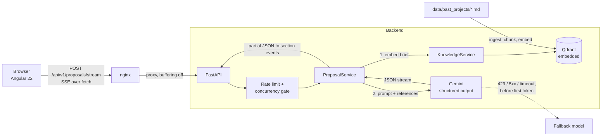

# RFP Proposal Copilot

Turns a client brief into a structured technical proposal (architecture, tech stack, scope with hour estimates, risks), **grounded in the company's own past projects**. The UI streams the proposal section by section and shows exactly which past projects the estimate is based on.

**Stack:** Angular 22 (signals, SSE over `fetch`) · FastAPI · Gemini (structured output + embeddings) · Qdrant · Docker Compose

## Why this is more than an API wrapper

An LLM asked to estimate a project from scratch is confidently wrong: with a naive prompt it quoted roughly **500 hours for projects in the 2,000 to 7,000 hour range**, and even after prompt calibration it still lands at 1,400 to 2,100 hours for them. Retrieval over past projects fixes most of that, and the evals measure it:

| 20 briefs, single run | in expected range | median error |
|---|---|---|
| Plain LLM (calibrated prompt) | 10% | 55% |
| **RAG over past projects** | **75%** | **14%** |
| RAG, briefs with a close analog | 90% | 8% |
| RAG, briefs that partly overlap | 83% | 14% |
| RAG, briefs with no analog in the corpus | 25% | 58% |

The last row is the honest limit: when nothing in the knowledge base applies, the system abstains from citing references, but the estimate is still too low. See [Known limitations](#known-limitations). Full methodology and per-brief results: [`backend/evals`](backend/evals/README.md).

## Architecture



**Request flow**

1. The brief is embedded (`RETRIEVAL_QUERY`) and matched against chunks of past projects in Qdrant.
2. Chunks are grouped by project, weak matches are dropped (similarity threshold), and the top 3 projects go into the prompt as real historical data.
3. Gemini returns a `ProposalDraft` as schema-constrained JSON, streamed. The server parses the partial JSON on every chunk and emits a `section` event whenever a field changed.
4. When the stream ends, the server validates the full draft, **computes the totals itself** (sum of feature hours), attaches the references and token/latency usage, and sends `complete`.

**SSE events:** `references` → `section` (many) → `complete`; plus `notice` (fallback model in use) and `error`.

## Running it

**With Docker** (everything, one command):

```bash
cp backend/.env.example backend/.env   # set GEMINI_API_KEY (and ADMIN_TOKEN if you want /knowledge/ingest)
docker compose up --build
```

Open <http://localhost:8081> (change with `FRONTEND_PORT`). The backend port is intentionally not published: only nginx can reach the API. On first start the backend indexes the past projects into the `qdrant-data` volume.

**Locally** (needs Node >= 22.22.3 for Angular 22, Python >= 3.12 and [uv](https://docs.astral.sh/uv/)):

```bash
cd backend && uv sync && uv run uvicorn app.main:app --reload   # http://localhost:8000/docs
cd frontend && npm ci && npx ng serve                           # http://localhost:4200
```

**Tests and evals**

```bash
cd backend
uv run pytest                          # 23 tests: rate limits, concurrency, fallback, auth
uv run python -m evals retrieval       # embeddings only, cheap
uv run python -m evals generation      # 40 Gemini calls (RAG vs no RAG), a few minutes
```

Stop the API server before running evals locally: the embedded Qdrant store can be opened by one process at a time.

## Key decisions and trade-offs

**Structure-aware chunking, one chunk per section.** Past projects are short documents with clear sections (overview, scope with hours, tech decisions, risks). Splitting on headings keeps a scope list intact, which fixed-size windows would cut mid-list. Each chunk is prefixed with the project title so it stays meaningful alone. Trade-off: it relies on a consistent document format.

**Qdrant in embedded mode.** No extra container for a corpus this size, and `QDRANT_URL` switches to a real server without code changes. Trade-off: one process can open the store at a time, so it does not scale horizontally as is.

**The model never does arithmetic.** Early on, `total_hours` was generated by the LLM. It is now computed from the feature list on the server, and the LLM output schema (`ProposalDraft`) does not contain it. Anything that can be computed or looked up is not left to the model: totals, references, token usage.

**Relevance threshold chosen by an eval, not by feel.** The first guess (0.6) kept irrelevant projects for every out-of-domain brief (0% abstention, 40% precision). A threshold sweep on 20 labelled briefs moved it to 0.70 (100% recall, 100% precision, 100% abstention). Caveat: it sits near a cliff (0.65 and 0.75 are both worse) and was tuned on a small set.

**Prompt calibration, measured.** Adding explicit estimation rules (hours cover QA, DevOps, PM and UAT; estimate module by module; never shrink the total because only part of the brief matches) took briefs with partial overlap from 17% to 83% in range. Caveat: the rules were written after seeing results on these same 20 briefs, so part of the gain may be fitting. A held-out set is the next step.

**Streaming structured output.** Gemini streams JSON text. `pydantic_core.from_json(..., allow_partial="trailing-strings")` parses each prefix, and the server diffs top-level fields into `section` events. The client therefore handles half-written items, and the UI renders sections as they appear instead of waiting 20+ seconds. `EventSource` is not usable (GET only), so the client reads `fetch` + `ReadableStream` and parses SSE itself (unit-tested, including multi-byte characters split across chunks).

**Fallback only before the first token.** On 429, 5xx or timeout the next model is tried. Once output has reached the client, falling back would splice two different proposals together, so the stream ends with an error instead.

**Abuse protection for a public demo.** Per-IP sliding-window rate limit, a cap on concurrent generations (non-blocking: 503 instead of queueing), a 4,000-character brief limit, and an admin token on the index rebuild endpoint (disabled when no token is configured). nginx overwrites `X-Forwarded-For`, and the API port is not published, which is what makes the client IP the rate limiter sees trustworthy.

**Retrieval failure degrades, it does not fail.** If embeddings or the vector store are down, the proposal is still generated, without references, and the UI says so.

## Known limitations

- **Out-of-domain estimates are too low.** With no analogous past project (4 of 20 eval briefs) the model falls back on general judgement and underestimates by about 50% or more. The system abstains from citing references, which is correct, but does not fix the number. Ideas: bottom-up estimation with explicit uncertainty ranges, or a calibration factor learned from the corpus.
- **The knowledge base is synthetic.** 8 hand-written past projects stand in for real, NDA-covered estimates. Retrieval quality on a larger, messier corpus is untested.
- **The eval set is small and partly self-authored.** Expected hour ranges are my judgement, and the briefs with a close analog were written to resemble corpus projects. One run per brief at temperature 0.2, so differences of a few points are noise.
- **Rate limits are in memory.** Fine for one process. With several instances they need to move to Redis.
- **Latency.** First token takes 10 to 20 seconds because the model spends about as many thinking tokens as output tokens. A lower thinking budget would cut it, at an unmeasured quality cost.
- **Not built:** auth and multi-tenancy, persistence of generated proposals, PDF/Markdown export, the agent-with-human-approval phase.

## Project layout

```
backend/
  app/
    api/            routes, rate limiting, auth dependencies
    rag/            chunking, embeddings, Qdrant store
    services/       ProposalService (generation, streaming, fallback), KnowledgeService (ingest, search)
    schemas/        Pydantic models: LLM output schema vs API response
  data/past_projects/   the knowledge base (markdown with front matter)
  evals/            20 labelled briefs, retrieval and generation suites, results
  tests/
frontend/
  src/app/proposal/     page, SSE client + parser, models
  nginx.conf            static hosting + API proxy with buffering off
docker-compose.yml
```
