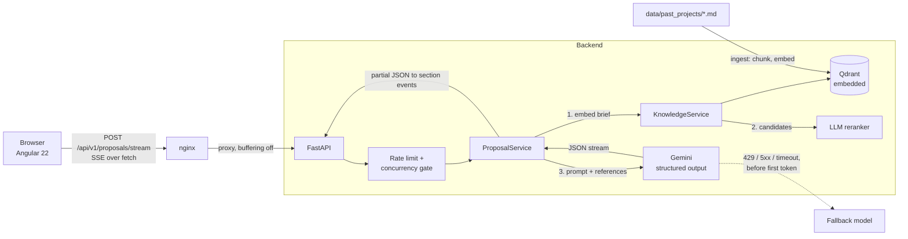

# RFP Proposal Copilot

[](https://github.com/Volodymyr-Palchynskyi/rfp-copilot/actions/workflows/ci.yml)

Turns a client brief into a structured technical proposal (architecture, tech stack, scope with hour estimates, risks), **grounded in the company's own past projects**. The UI streams the proposal section by section, shows exactly which past projects the estimate is based on (with the reranker's reason for each), and exports the finished proposal as Markdown.

**Stack:** Angular 22 (signals, SSE over `fetch`) · FastAPI · Gemini (structured output + embeddings) · Qdrant · Docker Compose

## Why this is more than an API wrapper

An LLM asked to estimate a project from scratch is confidently wrong: with a naive prompt it quoted roughly **500 hours for projects in the 2,000 to 7,000 hour range**, and even after prompt calibration it still lands at 1,000 to 2,000 hours for them. Retrieval over past projects fixes much of that. The evals measure it on four sets of briefs: 20 I tuned on, 15 held-out ones written afterwards, and two fresh sets (13 and 14 briefs) written later with stricter labels.

Cells are "share of briefs whose estimate lands in the expected range, median error":

| | no RAG | similarity threshold | LLM reranker | reranker + similarity floor |
|---|---|---|---|---|
| tuned set (20) | 15%, 56% | 75%, 14% | **95%, 8%** | not run |
| held-out set (15) | 13%, 53% | 60%, 26% | **80%, 20%** | not run |
| fresh set (13) | 15%, 57% | 38%, 35% | 38%, 34% | not run |
| fresh2 set (14), pre-registered | 7%, 57% | 50%, 33% | **79%, 12%** | 50%, 23% |
| fresh2, partial overlap (5) | 0%, 62% | 20%, 61% | **80%, 8%** | 60%, 16% |
| fresh2, nothing reusable (5) | 20%, 44% | 40%, 34% | 60%, 37% | 0%, 48% |

What the numbers say, and how much to trust them:

- **Retrieval beats no retrieval on every set**, by 23 to 80 points. That is the one conclusion I would defend.
- **The reranker was never worse than the threshold** (+20, +20, 0 and +29 points across the four sets). On the two sets that were still clean when I measured, it reached 59% against 44% (16 of 27 briefs against 12 of 27): a difference of four documents. Suggestive, not proven.
- **Where it helps is partial overlap.** A cosine threshold cannot separate a project that shares one module from an unrelated one (on the held-out set the best relevant score was 0.675, the best irrelevant 0.690), so it returns nothing and the estimate falls back to the model's low default. On fresh2 the threshold found no reference for four of five partial-overlap briefs, and for one of them estimated 1,692 hours against an expected 4,200 to 6,800; with the reranker the same brief came out at 5,590.
- **The numbers drift between sets.** The reranker scored 95%, 80%, 38% and 79%. The first set was used to build the system, the second shaped the reranker, and the fresh ones are small, so I treat the spread as noise plus fitting rather than as an estimate of real accuracy.

**A pre-registered idea that failed.** Before running fresh2 I fixed a "combined" rule (keep a project only if the judge scores it 2 or more **and** its cosine score is at least 0.65) and wrote down that I would run each configuration once and report all of them. The hypothesis was that it would beat the judge alone. It did not: 50% against 79%. The floor removed weak references that turned out to matter: for the warehouse stock-counting brief the combined rule kept none and estimated 1,155 hours (expected 1,800 to 3,200), while the judge kept one weak analogy and estimated 1,990. I read that as a hint, not a result: references with real hours may partly act as a **scale anchor** even when they are not true analogies, which would also explain why "nothing reusable" briefs sometimes improve with a weak reference. It is testable (give the model unrelated references and see what happens) and I have not tested it. The judge alone stays the default; the combined rule stays in the code behind `RERANK_REQUIRE_SIMILARITY` (default 0) as a tested and rejected option.

**The stubborn failure.** One brief (a real-time collaborative whiteboard, expected 3,000 to 5,500 hours) comes out near 1,000 hours with every configuration. When nothing in the corpus resembles the work, retrieval has nothing to offer, and the model underestimates hard problems such as real-time collaboration. That is what a larger and more varied knowledge base would address, not a better selection rule.

Caveats you should know before trusting any of this (details in [Known limitations](#known-limitations) and [`backend/evals`](backend/evals/README.md)): all five sets are small (one brief moves a percentage by 5 to 10 points); the expected hour ranges are my judgement, not real project outcomes; every cell is a single run at temperature 0.2; and all four later sets have now been looked at, so a new honest measurement needs new briefs.

## Architecture



**Request flow**

1. The brief is embedded (`RETRIEVAL_QUERY`) and matched against chunks of past projects in Qdrant.
2. Chunks are grouped by project. Candidates above a low similarity floor go to an LLM judge that scores each past project 0 to 3 by whether its modules are reusable for this brief (not by industry or keywords). Projects scoring 2 or more, at most 3, go into the prompt as real historical data, each with the judge's one-sentence reason, which the UI shows. If the judge fails, selection falls back to a plain similarity threshold.
3. Gemini returns a `ProposalDraft` as schema-constrained JSON, streamed. The server parses the partial JSON on every chunk and emits a `section` event whenever a field changed.
4. When the stream ends, the server validates the full draft, **computes the totals itself** (sum of feature hours), attaches the references and token/latency usage, and sends `complete`.

**SSE events:** `references` → `section` (many) → `complete`; plus `notice` (fallback model in use) and `error`.

## Running it

**With Docker** (everything, one command):

```bash
cp backend/.env.example backend/.env   # set GEMINI_API_KEY (and ADMIN_TOKEN if you want /knowledge/ingest)
docker compose up --build
```

Open <http://localhost:8081> (change with `FRONTEND_PORT`). The backend port is intentionally not published: only nginx can reach the API. On first start the backend indexes the past projects into the `qdrant-data` volume.

**Locally** (needs Node >= 22.22.3 for Angular 22, Python >= 3.12 and [uv](https://docs.astral.sh/uv/)):

```bash
cd backend && uv sync && uv run uvicorn app.main:app --reload   # http://localhost:8000/docs
cd frontend && npm ci && npx ng serve                           # http://localhost:4200
cd frontend && npx ng test --watch=false                        # 14 tests (SSE parser, Markdown export, app shell)
```

**Tests and evals**

```bash
cd backend
uv run pytest                          # 51 tests: rate limits, concurrency, model fallback, reranking, auth, data integrity
uv run python -m evals retrieval       # embeddings plus one reranker (LLM) call per brief, needs API quota
uv run python -m evals generation      # 40 Gemini calls (RAG vs no RAG), a few minutes
```

Stop the API server before running evals locally: the embedded Qdrant store can be opened by one process at a time.

## Key decisions and trade-offs

**Structure-aware chunking, one chunk per section.** Past projects are short documents with clear sections (overview, scope with hours, tech decisions, risks). Splitting on headings keeps a scope list intact, which fixed-size windows would cut mid-list. Each chunk is prefixed with the project title so it stays meaningful alone. Trade-off: it relies on a consistent document format.

**Qdrant in embedded mode.** No extra container for a corpus this size, and `QDRANT_URL` switches to a real server without code changes. Trade-off: one process can open the store at a time, so it does not scale horizontally as is.

**The model never does arithmetic.** Early on, `total_hours` was generated by the LLM. It is now computed from the feature list on the server, and the LLM output schema (`ProposalDraft`) does not contain it. Anything that can be computed or looked up is not left to the model: totals, references, token usage.

**Relevance threshold chosen by an eval, not by feel.** The first guess (0.6) kept irrelevant projects for every out-of-domain brief (0% abstention, 40% precision). A threshold sweep on 20 labelled briefs moved it to 0.70 (100% recall, 100% precision, 100% abstention). On the held-out briefs the same threshold gives 82% recall (100% precision and abstention): relevant and irrelevant similarity scores overlap, so a threshold alone is not a reliable relevance signal.

**Prompt calibration, measured.** Adding explicit estimation rules (hours cover QA, DevOps, PM and UAT; estimate module by module; never shrink the total because only part of the brief matches) took briefs with partial overlap from 17% to 83% in range. Caveat: the rules were written after seeing results on these same 20 briefs, and the held-out set confirms part of the gain was fitting (partial overlap: 83% on the tuned set, 40% on the held-out set).

**Streaming structured output.** Gemini streams JSON text. `pydantic_core.from_json(..., allow_partial="trailing-strings")` parses each prefix, and the server diffs top-level fields into `section` events. The client therefore handles half-written items, and the UI renders sections as they appear instead of waiting 20+ seconds. `EventSource` is not usable (GET only), so the client reads `fetch` + `ReadableStream` and parses SSE itself (unit-tested, including multi-byte characters split across chunks).

**Fallback only before the first token.** On 429, 5xx or timeout the next model is tried. Once output has reached the client, falling back would splice two different proposals together, so the stream ends with an error instead.

**Abuse protection for a public demo.** Per-IP sliding-window rate limit, a cap on concurrent generations (non-blocking: 503 instead of queueing), a 4,000-character brief limit, and an admin token on the index rebuild endpoint (disabled when no token is configured). nginx overwrites `X-Forwarded-For`, and the API port is not published, which is what makes the client IP the rate limiter sees trustworthy.

**LLM reranker instead of a smarter threshold.** Similarity scores of relevant and irrelevant projects overlap, so no cut-off works. The reranker judges *reusable modules*, one call per request for all candidates (about 3.6 s extra, low thinking effort), with the reason shown in the UI so the user can overrule it. Trade-offs: extra latency and cost, and it is more lenient than my eval labels. It keeps a reference for most "nothing similar" briefs (abstention 25% on the tuned set, 0% on the held-out set) because a past marketplace really does contain reusable checkout and payment modules. End-to-end it was never worse than the threshold and was clearly better on three of four sets, but its gain varies a lot between sets (see the table). It also weakens the "abstain when nothing applies" behaviour, and several over-estimates trace back to weak analogies it accepted (ski rental 2,190 h against 700 to 1,500; podcast platform 3,565 h against 1,500 to 3,000). I tried to make it stricter with a pre-registered similarity floor on top of the judge, and that made results worse on fresh2 (50% against 79%), so the judge alone is the default.

**CI runs everything that does not need an API key.** On every push: backend tests, frontend tests and production build, and a smoke test that boots the whole Docker stack with no key and checks the proxy, the admin guard and the 503 path. Evals are deliberately not in CI: they cost real quota and are slow. Offline tests also validate the hand-written data (every past project's scope hours must add up to its `total_hours`, eval sets must reference real projects). That check exists because it caught a real mistake of mine: one project said 3,400 hours in its metadata while its scope summed to 3,000, and the model had been shown both numbers. Earlier eval results used the inconsistent file; the effect is small (one of eight projects) but it means those numbers are not exactly reproducible.

**Retrieval failure degrades, it does not fail.** If embeddings or the vector store are down, the proposal is still generated, without references, and the UI says so.

## Known limitations

- **Briefs with nothing reusable in the corpus are the weakest case, and the answers there are inconsistent.** Across the two fresh sets the "nothing reusable" briefs landed in range 0% of the time on one and 60% on the other with the same reranker. A real-time collaboration brief is underestimated by about 3x under every configuration: when nothing in the corpus resembles hard work, the model's low default wins. A larger and more varied knowledge base is the real fix.
- **The knowledge base is synthetic.** 8 hand-written past projects stand in for real, NDA-covered estimates. Retrieval quality on a larger, messier corpus is untested.
- **The eval sets are small and self-authored.** 20 tuned briefs, 15 held-out ones (no longer pristine, I used its failures to design the reranker) and two fresh sets of 13 and 14 briefs (both spent: all configurations have been run on them). Each set is small enough that one brief moves a percentage by 5 to 10 points. Expected hour ranges are my judgement, not real project outcomes. One run per brief at temperature 0.2, so differences of a few points are noise.
- **Rate limits are in memory.** Fine for one process. With several instances they need to move to Redis.
- **Latency.** Reranking adds about 3.6 s before generation starts, and the first proposal token then takes 10 to 20 seconds because the model spends about as many thinking tokens as output tokens. A lower thinking budget would cut it, at an unmeasured quality cost.
- **Not built:** auth and multi-tenancy, persistence of generated proposals, PDF export, the agent-with-human-approval phase.

## Project layout

```
backend/
  app/
    api/            routes, rate limiting, auth dependencies
    rag/            chunking, embeddings, Qdrant store
    services/       ProposalService (generation, streaming, fallback), KnowledgeService (ingest, search)
    schemas/        Pydantic models: LLM output schema vs API response
  data/past_projects/   the knowledge base (markdown with front matter)
  evals/            20 labelled briefs, retrieval and generation suites, results
  tests/
frontend/
  src/app/proposal/     page, SSE client + parser, models
  nginx.conf            static hosting + API proxy with buffering off
docker-compose.yml
```
